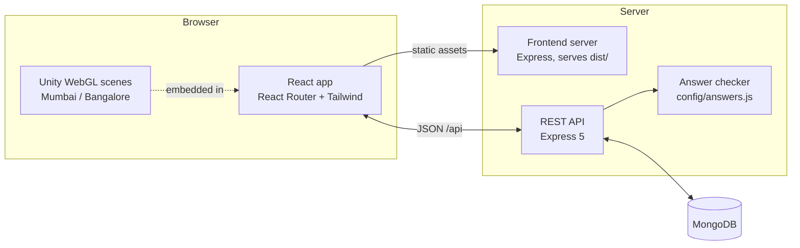

<div align="center">

# Chakravyuh

**A 90-minute, six-city espionage puzzle game that runs in the browser.**

Track a planned attack across India. Solve one city to unlock the next. Beat the clock.


Built by the **FYI Club, VIT Bhopal**

</div>

---

## Table of contents

- [Overview](#overview)
- [Features](#features)
- [How to play](#how-to-play)
- [Architecture](#architecture)
- [Tech stack](#tech-stack)
- [Quick start](#quick-start)
- [Configuration](#configuration)
- [API reference](#api-reference)
- [Security model](#security-model)
- [Deployment](#deployment)
- [Project structure](#project-structure)
- [Troubleshooting](#troubleshooting)
- [Roadmap](#roadmap)
- [Contributing](#contributing)
- [Contributors](#contributors)

## Overview

Chakravyuh is a timed puzzle game designed for club events and hackathon-style competitions. Each participant registers as an agent and has **90 minutes** to move through **six Indian cities**, solving a different puzzle in each one. The puzzles combine embedded 3D scenes, document analysis and deduction, and together they reveal the location, date, time and scale of a planned attack.

Finish the final city correctly and your remaining time becomes your score on a live leaderboard. Get the final answer wrong, or run out of time, and you are disqualified.

## Features

- **Six sequential levels.** Each city has a story briefing and a puzzle, and a city only unlocks once the previous one is solved.
- **Embedded Unity WebGL scenes** for the Mumbai and Bangalore levels, with no plugin or install needed.
- **Server-side answer checking.** Correct answers live only on the backend and are never shipped to the browser.
- **Server-enforced rules.** City order, the 90-minute limit and disqualification are all decided by the server, not the client.
- **Brute-force protection.** Each player is limited in how many wrong guesses they can make per minute.
- **Live leaderboard** with event statistics, an active-players view with time remaining, and a top-10 ranking. IDs are masked on this public page.
- **Resumable sessions.** Refreshing or reopening the app returns a player to their current city with their original clock.

## How to play

1. **Register** with your registration number, name and `@vitbhopal.ac.in` email. The 90-minute clock starts.
2. **Read the briefing** for each city, then open its puzzle.
3. **Solve the puzzle** and submit your answer. A correct answer unlocks the next city.
4. **Reach Delhi** and submit your final assessment of where, when and how large the attack is.

| # | City | Challenge |
|---|------|-----------|
| 1 | Mumbai | Explore a 3D scene and recover a 3-digit access code |
| 2 | Bangalore | Explore a second 3D scene and recover a passcode |
| 3 | Pune | Analyse a device synchronisation report and enter four parameters |
| 4 | Chennai | Work through recovered documents to identify an NGO |
| 5 | Jammu | Read an intel log and make a Yes/No assessment. The wrong call ends your game |
| 6 | Delhi | Final submission: city, date, time and number of locations |

**Scoring:** points are the seconds left on your clock when you submit the final answer, so faster is better.

## Architecture



The browser never sees a correct answer. It sends a guess to `POST /api/game/verify`, and the API checks it against secrets held in the backend environment, enforces order and time, and records progress in MongoDB.

## Tech stack

| Layer | Technology |
|-------|-----------|
| Frontend | React 19, React Router 7, Vite 7, Tailwind CSS 3, Axios |
| Puzzle scenes | Unity WebGL builds, embedded via `<iframe>` |
| Backend | Node.js, Express 5, Mongoose 9 |
| Database | MongoDB (local or Atlas) |
| Production web server | Small Express server that serves the build with the headers Unity needs |

## Quick start

### Prerequisites

- **Node.js 20.19 or newer** (required by Vite 7)
- **MongoDB**: a local instance, or a free [MongoDB Atlas](https://www.mongodb.com/atlas) cluster

### 1. Clone

```bash
git clone https://github.com/fyiclub-vitb/Chakravyuh.git
cd Chakravyuh
```

### 2. Start the backend

```bash
cd backend
cp .env.example .env      # set MONGO_URI and the puzzle answers
npm install
npm start
```

You should see `Server running on port 5000` and `MongoDB Connected`.

### 3. Start the frontend

```bash
cd frontend
cp .env.example .env      # only VITE_API_URL is needed
npm install
npm run build
npm start
```

Open <http://localhost:3000>.

> **Use the production build, not `npm run dev`, to play.** The Unity scenes ship as pre-compressed `.gz` files and need the headers that `frontend/server.js` sets. `npm run dev` (<http://localhost:5173>) is fine for working on the React UI, but the 3D levels may not load there.

## Configuration

### Backend: `backend/.env`

| Variable | Required | Description |
|----------|:--------:|-------------|
| `MONGO_URI` | Yes | MongoDB connection string |
| `PORT` | No | API port. Defaults to `5000` |
| `MUMBAI_PASSCODE` | Yes | Answer for Mumbai |
| `BANGALORE_PASSCODE` | Yes | Answer for Bangalore (case-insensitive) |
| `PUNE_DEVICE_ID`, `PUNE_FREQUENCY_BAND`, `PUNE_SIGNAL_STRENGTH`, `PUNE_DELAY_OFFSET` | Yes | The four Pune answers |
| `CHENNAI_NGO_NAME` | Yes | Answer for Chennai (case-insensitive, spaces ignored) |
| `JAMMU_CORRECT_ANSWER` | No | Correct Yes/No call. Defaults to `no` |
| `DELHI_CITY`, `DELHI_DATE`, `DELHI_TIME`, `DELHI_PLACES` | Yes | The four Delhi answers. Date ignores `st/nd/rd/th` and spaces, and time ignores minutes and spaces |
| `MAX_WRONG_ATTEMPTS_PER_MINUTE` | No | Wrong guesses allowed per player per minute. Defaults to `5` |

A missing answer variable makes verification for that city return `500` instead of guessing.

### Frontend: `frontend/.env`

| Variable | Description |
|----------|-------------|
| `VITE_API_URL` | Backend base URL including `/api`, for example `http://localhost:5000/api` |

Anything prefixed with `VITE_` is baked into the public JavaScript at build time. **Never put a secret in a `VITE_` variable.**

## API reference

Base URL: `http://localhost:5000/api`. Requests and responses are JSON.

| Method | Endpoint | Purpose |
|--------|----------|---------|
| `POST` | `/auth/register` | Create a player and start their clock, or resume an existing one |
| `POST` | `/game/verify` | Check an answer for a city (see below) |
| `POST` | `/game/disqualify` | Disqualify a player, only valid once their 90 minutes have run out |
| `GET` | `/game/leaderboard` | Public statistics, top 10 and active players (IDs masked) |

### `POST /game/verify`

Request body: `{ "userId", "city", "answers" }`, where `answers` depends on the city:

| City | `answers` |
|------|-----------|
| Mumbai, Bangalore | `{ "code" }` |
| Pune | `{ "deviceId", "frequencyBand", "signalStrength", "delayOffset" }` |
| Chennai | `{ "ngoName" }` |
| Jammu | `{ "answer": "yes" or "no" }` |
| Delhi | `{ "city", "date", "time", "places" }` |

| Status | Meaning |
|:------:|---------|
| `200` `correct: true` | Correct. The city is marked complete. For Delhi, the final answers are stored and the clock stops |
| `200` `correct: false` | Wrong answer, try again. In Jammu and Delhi the response also has `disqualified: true` and the game ends |
| `403` | Already disqualified, or the 90 minutes are over |
| `409` | City not unlocked yet, already completed, or final answer already submitted |
| `429` | Too many wrong guesses. Wait a minute |

## Security model

The game is designed so that a player cannot get ahead by tampering with the browser.

| Concern | How it is handled |
|---------|-------------------|
| Reading answers from the page source | Answers exist only in `backend/.env`. The frontend bundle contains none |
| Marking a city complete without solving it | Progress is written only by the server, inside `/verify`, after a correct answer |
| Skipping levels | `/verify` accepts only the player's next unsolved city |
| Extending the clock | The server enforces the 90-minute limit. The on-screen timer is display only |
| Disqualifying other players | `/disqualify` refuses unless the player's time has actually expired |
| Guessing codes by script | Wrong guesses are rate-limited per player |
| Leaking identities | The public leaderboard shows masked IDs (`24BCE•••••`) and no emails |
| Leaking internals | Server errors return a generic message, never raw error text |

**Known limitations:**

- A player is identified only by their registration number, with no password or session token. Anyone who knows another player's number can resume that session.
- The rate limiter is in memory. It resets on restart and does not span multiple server instances.
- `/auth/register` does not yet validate the ID or email format on the server. The format is enforced only in the browser.

## Deployment

1. **Database:** create a MongoDB Atlas cluster, or run MongoDB on your own host.
2. **Backend:** deploy `backend/` to any Node host (Render, Railway, a VM). Set `MONGO_URI` and every answer variable in the host's environment settings. Do not commit `.env`.
3. **Frontend:** set `VITE_API_URL` to the public backend URL, then:

   ```bash
   cd frontend
   npm install
   npm run build
   npm start          # serves dist/ on PORT (default 3000)
   ```

If you host the frontend on a static platform such as Vercel or Netlify instead, you must reproduce the headers that `frontend/server.js` sets (`Content-Encoding: gzip` for the Unity `.gz` files, correct MIME types, and the `Cross-Origin-Opener-Policy` and `Cross-Origin-Embedder-Policy` headers). Otherwise the Mumbai and Bangalore scenes will not load.

## Project structure

```
Chakravyuh/
├── backend/
│   ├── server.js              # Express app and route mounting
│   ├── config/
│   │   ├── db.js              # MongoDB connection
│   │   └── answers.js         # Server-side answer checking
│   ├── models/User.js         # Player schema
│   └── routes/
│       ├── auth.js            # Registration / login
│       └── game.js            # verify, disqualify, leaderboard
├── docs/
│   └── contributors-banner.svg   # README banner
└── frontend/
    ├── server.js              # Production server (headers for Unity)
    ├── public/                # Unity WebGL builds (Mumbai, Bangalore)
    └── src/
        ├── App.jsx            # Routes
        ├── components/        # ProgressGuard
        ├── hooks/             # useProgressCheck
        ├── utils/             # api.js (verifyAnswer), progressHelper.js
        ├── assets/            # Story images
        └── pages/             # Home, Register, Leaderboard, Disqualify, one folder per city
```

## Troubleshooting

| Symptom | Likely cause and fix |
|---------|----------------------|
| The Mumbai or Bangalore scene is blank or stuck loading | You are on `npm run dev`. Use `npm run build && npm start`, or serve the build with the Unity headers |
| Every answer returns a `500` error | An answer variable is missing in `backend/.env`. The server log names which one |
| `ECONNREFUSED` or "Network Error" in the browser | The backend is not running, or `VITE_API_URL` is wrong. It must include `/api`. Rebuild the frontend after changing it |
| Backend exits right after starting | `MONGO_URI` is wrong or MongoDB is unreachable (for Atlas, check the IP allow-list) |
| "Too many incorrect attempts" | The per-minute wrong-guess limit was hit. Wait a minute |
| Changed `frontend/.env` but nothing happened | Vite reads it at build time. Restart `npm run dev` or run `npm run build` again |

## Roadmap

- [ ] Authenticated sessions, so a registration number alone cannot be used to log in
- [ ] Server-side validation of registration number and email format
- [ ] Shared rate-limit store (for example Redis) for multi-instance deployments
- [ ] Compress the story images (currently 9-10 MB each) for faster first load
- [ ] Automated tests and CI
- [ ] Admin view for organisers: reset a player, view progress, export results

## Contributing

Contributions are welcome.

1. Fork the repository and create a branch: `git checkout -b feature/your-change`
2. Make your change, and run `npm run lint` in `frontend/`
3. Never commit `.env` files or puzzle answers
4. Open a pull request describing what changed and why

For a new puzzle or city, add its answer check to `backend/config/answers.js` and its variables to `backend/.env.example`. Never check answers in the frontend.

## Contributors


Built by the FYI Club, VIT Bhopal, with contributions from the Technical Team.

### Special Credit

<table align="center">
  <tr>
    <td align="center" width="170">
      <a href="https://github.com/Vansh-kash2023">
        <br>
        <sub><b>Vansh Kashyap</b></sub>
      </a><br>
      <sub><a href="https://github.com/Vansh-kash2023">@Vansh-kash2023</a></sub>
    </td>
    <td align="center" width="170">
      <a href="https://github.com/Paurush-Nimje">
        <br>
        <sub><b>Paurush Nimje</b></sub>
      </a><br>
      <sub><a href="https://github.com/Paurush-Nimje">@Paurush-Nimje</a></sub>
    </td>
  </tr>
</table>


### All contributors

<a href="https://github.com/fyiclub-vitb/Chakravyuh/graphs/contributors">
  
</a>